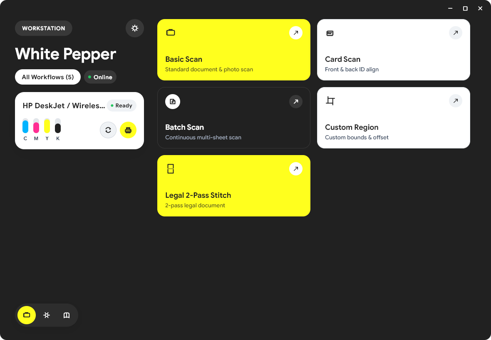
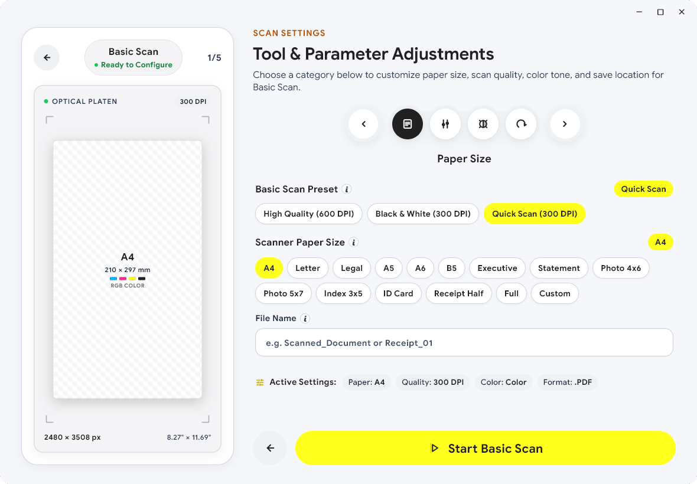
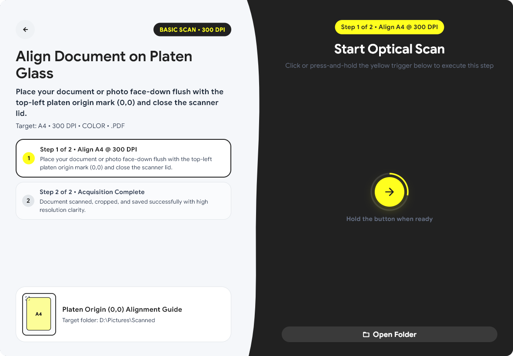
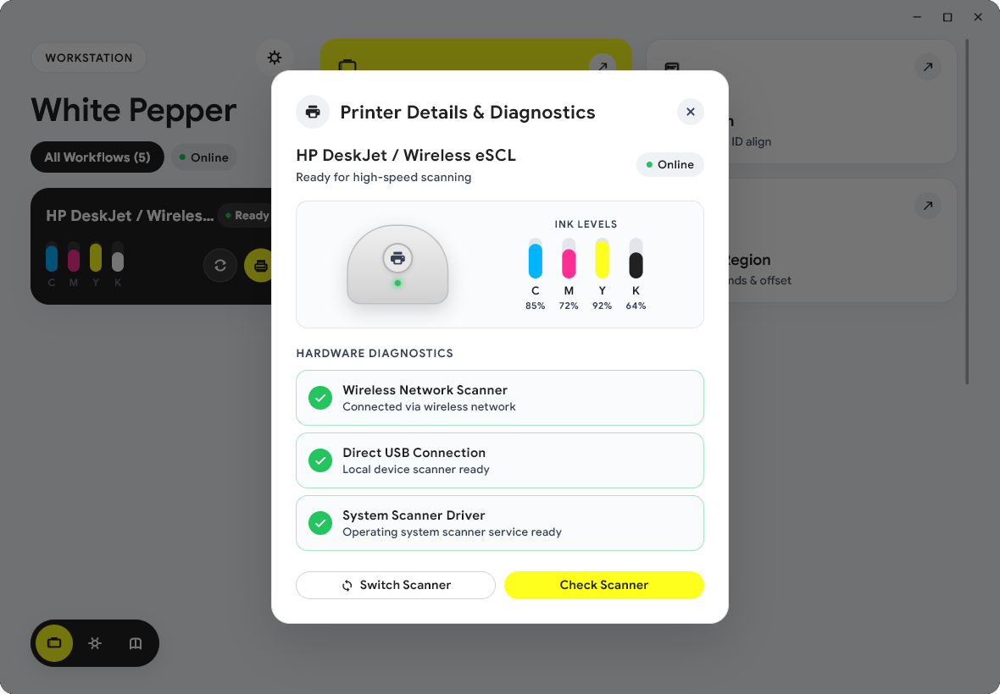
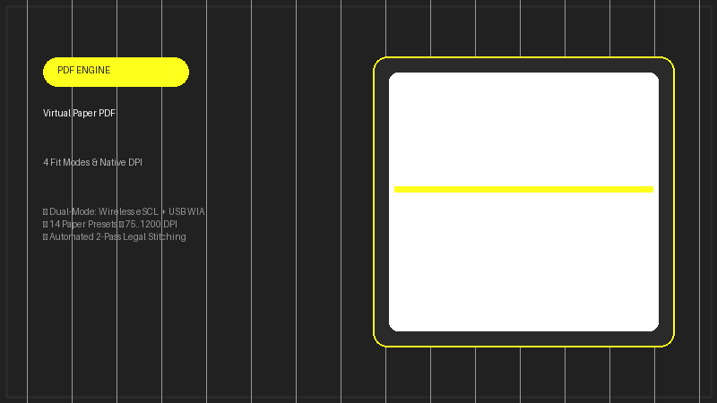
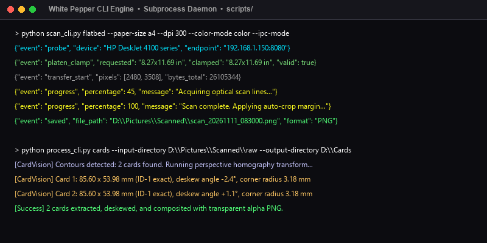

# 🌶️ White Pepper Desktop Workstation 🖥️

📱 **A Minimalist, Zero-Touch Flatbed Scanner Suite and Vision Workstation built with Flutter Desktop.**

Built specifically for Windows 10/11 x64, **White Pepper** brings an edge-to-edge, frameless, and modern scanning experience to your desktop! Whether you need one-touch ISO document archiving, automated ID-1 card acquisition with rounded corner masking, multi-document batch compilation, precision custom region clipping, or an intelligent 2-pass legal stitcher for standard flatbeds, White Pepper provides an all-day, beautifully animated, zero-clutter workstation right out of the box. 🚀

* **Homepage & Interactive Documentation**: [https://aceburgundy.github.io/White-Pepper/](https://aceburgundy.github.io/White-Pepper/)
* **Standalone CLI Engine Repository**: [https://github.com/AceBurgundy/White-Pepper-CLI](https://github.com/AceBurgundy/White-Pepper-CLI)
* **Latest GitHub Release (`v1.3.0`)**: [https://github.com/AceBurgundy/White-Pepper/releases/tag/v1.3.0](https://github.com/AceBurgundy/White-Pepper/releases/tag/v1.3.0)

---

## 📦 Requirements & Installation

Before installing or running from source, ensure your environment meets the minimum version constraints:

* **Windows OS (`10 / 11 64-bit`)**: The target desktop operating system.
* **Flutter SDK (`>= 3.24.0`) & Dart (`>= 3.5.0`)**: For compiling the desktop frontend from source.
* **Python (`>= 3.11`)**: Bundled automatically by the installer, or installed on the system for direct CLI engine orchestration.
* **Network / USB Scanner**: Any eSCL-compatible wireless scanner (HP, Epson, Canon, Brother, Mopria/AirScan) or standard Windows WIA USB scanner.

### Option 1: Compiled Windows Setup Installer (Recommended) 💿

Download the standalone, digitally compiled installer executable from the GitHub Releases portal:

1. Download [`WhitePepper-Desktop-Setup-v1.3.0.exe`](https://github.com/AceBurgundy/White-Pepper/releases/download/v1.3.0/WhitePepper-Desktop-Setup-v1.3.0.exe).
2. Run the installer setup wizard. It automatically configures desktop shortcuts, registers start menu entries, and bundles all required Flutter engine DLLs and Python acquisition hooks.
3. Launch **White Pepper** from your desktop or start menu.

### Option 2: Build From Source 🛠️

```powershell
# Clone the canonical repository and initialize the standalone CLI engine submodule
git clone --recurse-submodules https://github.com/AceBurgundy/White-Pepper.git
cd White-Pepper

# Fetch Flutter dependencies
flutter pub get

# Launch in native Windows desktop debug mode
flutter run -d windows

# Build optimized 64-bit release binary
flutter build windows --release
```

---

## 🚀 Core Features & Modern Architecture

* 🖨️ **Zero-Touch Hardware Auto-Connect & Inverted White Night Card:** Automatically discovers eSCL wireless scanners across your Wi-Fi subnet and local Windows WIA USB devices. Seamlessly auto-pairs without manual IP configuration. On Night Mode, the dashboard printer card dynamically transforms into an inverted pure white card (`#FFFFFF`) with deep onyx typography (`#1E1E1E`), dark status badge, neutral gray tracks, and onyx 'K' ink bar for optimal visual contrast.
* 🔄 **Single-Click Encircling Scanner Switcher:** Switch between multiple networked or plugged-in scanners on the fly using a dedicated encircling icon button and a clean selection modal.
* 📊 **View Printer Dialog & Diagnostics:** Inspect live Cyan, Magenta, Yellow, and Key/Black (C/M/Y/K) ink levels, check online/standby hardware status, and run real-time eSCL/WIA communication probes with a single click.
* 🎨 **Optical Platen Real-Time Visual Simulation Engine:** The left side of the options deck renders a live, mathematically accurate representation of the physical scanner platen:
  * **Proportional Paper Scaling:** True aspect-ratio rendering where Full Platen (`0.92 × 0.92`) occupies the maximum glass area, A4 (`0.895 × 0.833`) is narrower than Letter and shorter than Full Platen, and Letter (`0.92 × 0.783`) spans full platen width while remaining noticeably shorter than A4.
  * **Dynamic DPI Checkered Density:** Simulates scan resolution with an inverse grid density formula (`2400 / dpi`), generating ultra-fine grid textures at 600–1200 DPI and coarse tiles at 75–150 DPI.
  * **Crop Margin Brackets & Guidelines:** Dashed alignment perimeter with 4 L-corner registration brackets delineating the active scanning boundaries.
  * **Color Mode Sheet Strips:** Real-time visual sample strips including CMYK 4-swatch bars for RGB Color, an 8-bit gradient ramp for Grayscale, and stark high-contrast line art for 1-bit B&W.
* 🎛️ **Borderless Options Control Deck & PeaPod Drawer:** Seamless borderless parameter drawer with smooth mouse hover feedback, pointer cursor, and descriptive tooltips across all options.
* 💳 **Guided Card Scan Workflow:** Built-in guidance instructing users to position cards *"Front Down on the corner with 0.5 inch space away from the corner"*. Scans a precise 4-inch capture window, deskews orientation, masks rounded corners to transparent PNGs, and supports dual-pass front/back sequencing saving as `<name> - Front` and `<name> - Back`.
* 📑 **Hardware-Aware Legal 2-Pass Stitcher:** Dynamically detects whether the connected scanner's physical platen is shorter than a standard Legal page (`8.50" × 14.00"`). When platen constraints require it, the workflow card is presented to guide the user through top/bottom scanning, optical overlap feature matching, seam blending, and unified PDF generation.
* 📑 **Curated 5-Workflow Suite:**
  1. **Basic Scan:** One-touch digitization with dedicated quick-presets for *High Quality* (600 DPI), *B&W Text* (300 DPI thresholded), and *Quick Scan* (300 DPI Color).
  2. **Card Scan:** Automated ID-1 card acquisition with rounded corner transparency.
  3. **Custom Region Scan:** Precision coordinate platen cropping with custom offset & dimension selection.
  4. **Batch Scan:** Multi-document compilation into PDF or archive formats.
  5. **Legal 2-Pass Stitch:** Guided split scanning and algorithmic seam stitching for oversized documents.
* ✨ **Pure Icon-Driven Component Animations:** Zero jarring button background or shadow shifts on hover. Interactive states across action buttons, navigation controls, and workflow triggers are communicated strictly through expressive, custom-painted vector line icon animations (e.g. bouncing scanner rays, retracting arrows, and animated crop corner brackets).
* 🌌 **Atmospheric Dual-Orb Startup Splash:** Synchronized dual-orb loading animation matching the web documentation style, smoothly bridging application initialization and device discovery.
* ☀️ **All-Day Adaptive Theming & Frameless Window:** Native Windows frameless window title bar with drag-to-move, maximize, minimize, close controls, and seamless day/night theme transitions.

---

## 💻 Visual Walkthrough & System Screenshots

Below is a breakdown of the primary screens, interactive tools, and hardware integrations within White Pepper.

### 1️⃣ The Desktop Scanner Workstation 🖥️



The central workstation dashboard provides an uncluttered workspace. The left panel showcases the active scanner status, current network endpoint, live C/M/Y/K ink meters, and direct access to printer details and scanner switching. In Night Mode, this card renders in high-contrast inverted pure white. The right section features the curated 5-workflow deck.

### 2️⃣ Optical Platen Canvas & Options Control Deck 🎛️



The options screen integrates a live physical platen simulation on the left with proportional paper sheets (`Full`, `A4`, `Letter`), dynamic DPI checkered density, crop margin guidelines, and color mode strips. The right section features the PeaPod interactive drawer for fast parameter configuration.

### 3️⃣ Guided Step-by-Step Instructions & Live Terminal ⚡



Each workflow presents guided, step-by-step physical placement instructions (such as the 0.5-inch corner offset for Card Scan), accompanied by an animated circular progress trigger button and real-time streaming console execution feedback.

### 4️⃣ Zero-Touch Scanner Discovery & Hardware Dialog 🖨️



Tapping **View Printer** reveals live C/M/Y/K ink level gauges, scanner model identity, and diagnostic check items. The **Switch Scanner** modal scans your local network subnet and USB ports to present all detected scanning devices for instant auto-pairing.

### 5️⃣ Virtual-Paper PDF Compiler & Presets 📑



Compile raw scan captures into publication-ready PDF documents with virtual paper sizing (`A4`, `Letter`, `Legal`, `A5`, `Photo`), customizable margins, JPEG compression quality, and four fit modes (`contain`, `fill`, `stretch`, `original`).

### 6️⃣ Headless CLI Engine & Protocol Abstraction ⚡



White Pepper decouples frontend user interactions from hardware acquisition. The bundled CLI engine (`scripts/`) runs out-of-process, interfacing directly with eSCL HTTP/XML endpoints and native Windows WIA COM interfaces, streaming progress back to the Flutter UI in real time.

```powershell
# Execute direct flatbed scan from the command line
python scripts/scan_cli.py flatbed --paper-size a4 --dpi 300 --color-mode color --format pdf

# Batch extract and deskew ID cards
python scripts/process_cli.py cards --input-dir D:\Pictures\Scanned --dpi 600 --background white
```

---

## 📸 System Interface Gallery & Visual Reference

The official application screenshots illustrate White Pepper's visual hierarchy, adaptive theming, and real-time vision feedback:

| View Reference | Screen / Window | Theme | Key Elements Showcased |
| :--- | :--- | :--- | :--- |
| [`preview_desktop_ui.png`](images/preview_desktop_ui.png) | **Main Dashboard Screen** | **Night Mode** | Inverted pure white printer card on the left with C/M/Y/K ink levels; the 5 curated workflow cards on the right (Basic Scan, Card Scan, Custom Region, Batch Scan, Legal 2-Pass Stitch); frameless title bar. |
| [`preview_options_deck.png`](images/preview_options_deck.png) | **Options Control Deck** | **Night Mode** | Optical Platen Canvas on the left showing proportional paper sizing, DPI checkered density tiles, crop margin brackets, and color mode strip; borderless PeaPod drawer on the right. |
| [`preview_instructions.png`](images/preview_instructions.png) | **Instructions Screen** (Card Scan) | **Night Mode** | Organic wavy header divider; guided placement instructions (*"Front Down on corner with 0.5\" space"*); animated progress trigger button; live streaming console terminal output. |
| [`hardware_banner.png`](images/hardware_banner.png) | **View Printer Modal** | **Night Mode** | "Printer Information & Capabilities" dialog showing Cyan/Magenta/Yellow/Black ink bars, connection endpoint, and diagnostic check status. |

---

## 🎨 The Minimalist Design System

White Pepper follows an uncompromising design system implemented in [`design_tokens.dart`](lib/core/theme/design_tokens.dart):

* **`DesignTokens.onyx` (`#212121`)**: Primary dark background and high-contrast typography.
* **`DesignTokens.accentYellow` (`#FFFF1E`)**: Signature neon yellow accent for active pills, sliders, and progress buttons.
* **`DesignTokens.pureWhite` (`#FFFFFF`)**: Crisp foreground cards, badges, and icon fills.
* **`DesignTokens.darkSurfaceOne` through `Six`**: Calibrated dark mode elevations (`#2A2A2A` to `#3D3D3D`).
* **`DesignTokens.radiusPill` (`100.0`) & `radiusCardOuter` (`22.0`)**: Smooth rounded geometry across buttons and viewport cards.
* **`DesignTokens.shadowWorkstation`**: Multi-layer soft elevation shadows mimicking natural optical glass depth.

---

## 🗂️ Project Architecture

The Flutter codebase follows strict clean architecture separation:

* **`lib/main.dart`**: Desktop window manager initialization, frameless window styling, and root provider configuration.
* **`lib/core/theme/`**: Centralized design tokens and typography themes.
* **`lib/models/`**: Strongly typed data models:
  * `ScanConfigurationModel`: Scan parameters, paper size, DPI, format, and backend targeting.
  * `ScannerDeviceModel`: Network host, port, transport type (`wifi` / `usb`), and online status.
  * `WorkflowType`: Workflow definitions, titles, badges, and icon keys.
* **`lib/providers/`**:
  * `AppState`: Core business logic notifier managing scanner auto-discovery, zero-touch failover, execution loops, and active tool states.
* **`lib/screens/`**:
  * `dashboard/`: Sidebar status card, encircling switch button, and scrollable workflow cards grid.
  * `options/`: Borderless options control deck, platen calculation helper, and 1.5x PeaPod interactive drawer.
  * `instructions/`: Real-time workflow stepper, process button, and live sanitized terminal activity monitor.
  * `splash/`: Atmospheric dual-orb startup loading screen.
* **`lib/services/`**:
  * `CliCommandBuilder`: Converts high-level UI configurations into validated CLI engine arguments.
  * `ScannerProcessService`: Asynchronous process runner spawning Python child processes with stream redirection.
* **`lib/widgets/`**: Reusable UI components:
  * `animated_line_icon.dart`: Pure vector line animation engine driving icon transitions across buttons and cards.
  * `platen_preview_canvas.dart`: Real-time optical platen simulator with proportional paper geometry, DPI checkered tiles, and crop margins.
  * `dialogs/`: App settings dialog, hardware connect / ink level dialog, scanner selector dialog.
  * `peapod/`: PeaPod drawer, slider controls, and custom metaball droplet indicator.
  * `window/`: Custom draggable frameless title bar with minimize, maximize, and close buttons.
* **`scripts/`**: Git submodule pointing directly to the standalone [White-Pepper-CLI](https://github.com/AceBurgundy/White-Pepper-CLI) engine.

---

## 🔗 Links & Repositories

* **Desktop Application Repository**: [https://github.com/AceBurgundy/White-Pepper](https://github.com/AceBurgundy/White-Pepper)
* **Standalone CLI Engine Repository**: [https://github.com/AceBurgundy/White-Pepper-CLI](https://github.com/AceBurgundy/White-Pepper-CLI)
* **Interactive Documentation Portal**: [https://aceburgundy.github.io/White-Pepper/](https://aceburgundy.github.io/White-Pepper/)
* **Releases & Binary Downloads**: [https://github.com/AceBurgundy/White-Pepper/releases](https://github.com/AceBurgundy/White-Pepper/releases)

---

## 📜 License

This project is licensed and distributed under the **Mozilla Public License 2.0 (MPL-2.0)**.

## 👤 Author

* **Name:** AceBurgundy
* **Email:** Samadriansabalo99@gmail.com
* **GitHub:** [@AceBurgundy](https://github.com/AceBurgundy)
