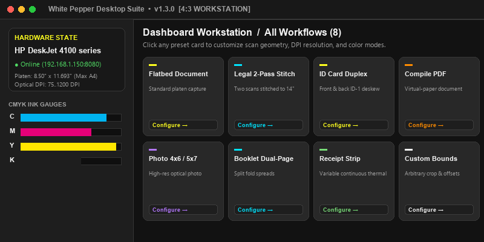
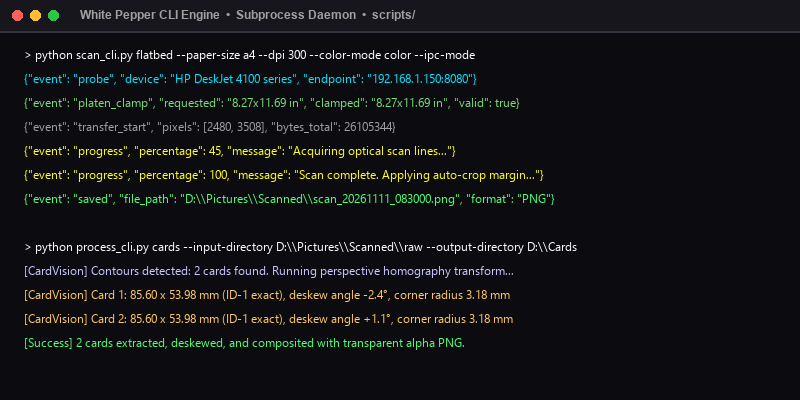
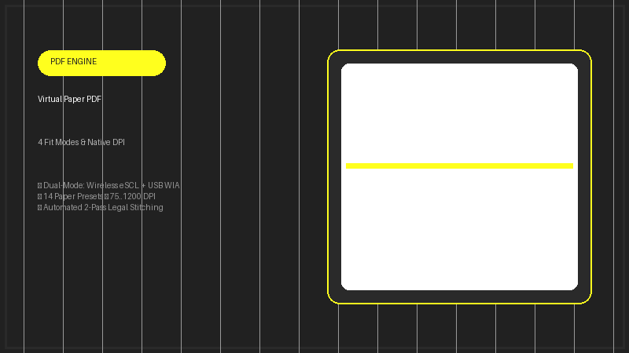
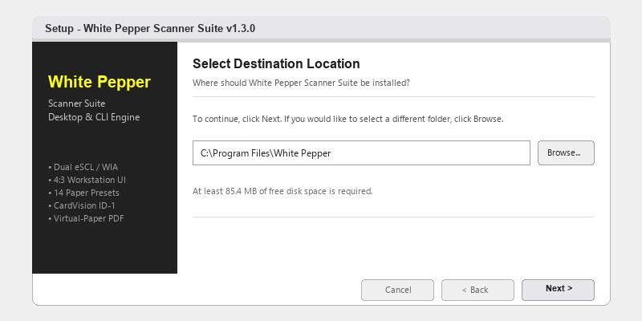

# 🌶️ White Pepper Desktop Workstation 🖥️

📱 **A Minimalist, Zero-Touch Flatbed Scanner Suite and Vision Workstation built with Flutter Desktop.**

Built specifically for Windows 10/11 x64, **White Pepper** brings an edge-to-edge, frameless, and modern scanning experience to your desktop! Whether you need one-touch ISO document archiving, automatic ID-1 plastic card extraction with rounded corners, multi-page booklet dual-page splitting, or a 2-pass legal document stitcher for standard flatbed scanners, White Pepper provides an all-day, beautifully animated, zero-clutter workstation right out of the box. 🚀

* **Homepage & Interactive Documentation**: [https://aceburgundy.github.io/White-Pepper/](https://aceburgundy.github.io/White-Pepper/)
* **Standalone CLI Engine Repository**: [https://github.com/AceBurgundy/White-Pepper-CLI](https://github.com/AceBurgundy/White-Pepper-CLI)
* **Latest GitHub Release (`v1.3.0`)**: [https://github.com/AceBurgundy/White-Pepper/releases/tag/v1.3.0](https://github.com/AceBurgundy/White-Pepper/releases/tag/v1.3.0)

---

## 📦 Requirements & Installation

Before installing or running from source, ensure your environment meets the minimum version constraints:

* **Windows OS (`10 / 11 64-bit`)**: The target desktop operating system.
* **Flutter SDK (`>= 3.24.0`) & Dart (`>= 3.5.0`)**: For compiling the desktop frontend from source.
* **Python (`>= 3.11`)**: Bundled automatically by the installer, or installed on the system for direct CLI engine orchestration.
* **Network / USB Scanner**: Any eSCL-compatible wireless scanner (HP, Epson, Canon, Brother, Mopria/AirScan) or standard Windows WIA USB scanner.

### Option 1: Compiled Windows Setup Installer (Recommended) 💿

Download the standalone, digitally compiled installer executable from the GitHub Releases portal:

1. Download [`WhitePepper-Desktop-Setup-v1.3.0.exe`](https://github.com/AceBurgundy/White-Pepper/releases/download/v1.3.0/WhitePepper-Desktop-Setup-v1.3.0.exe).
2. Run the installer setup wizard. It automatically configures desktop shortcuts, registers start menu entries, and bundles all required Flutter engine DLLs and Python acquisition hooks.
3. Launch **White Pepper** from your desktop or start menu.

### Option 2: Build From Source 🛠️

```powershell
# Clone the canonical repository and initialize the standalone CLI engine submodule
git clone --recurse-submodules https://github.com/AceBurgundy/White-Pepper.git
cd White-Pepper

# Fetch Flutter dependencies
flutter pub get

# Launch in native Windows desktop debug mode
flutter run -d windows

# Build optimized 64-bit release binary
flutter build windows --release
```

---

## 🚀 Core Features

* 🖨️ **Zero-Touch Hardware Auto-Connect:** Automatically discovers eSCL wireless scanners on your local Wi-Fi subnet and local Windows WIA USB devices. Seamlessly auto-connects to the active scanner with zero user intervention or IP configuration.
* 🔄 **Single-Click Encircling Scanner Switcher:** Switch between multiple networked or plugged-in scanners on the fly using a dedicated encircling icon button and a clean selection modal.
* 📊 **View Printer Dialog & Diagnostics:** Inspect live C/M/Y/K ink levels, check online/standby hardware status, and run real-time eSCL/WIA communication probes with a single click.
* 🎛️ **Borderless Options Control Deck:** A sleek, borderless options deck with a 1.5x scaled interactive PeaPod slider bar for rapid adjustments across paper presets, DPI resolution, color modes, rotation, contrast, and output directories.
* 💳 **Intelligent ID-1 Card Vision:** Scans ID cards and driver's licenses, deskews orientation, extracts boundaries, applies configurable corner radii (default `3.18 mm`), and composites onto clean white or transparent backgrounds.
* 📖 **Dual-Page Booklet Splitter:** Batch split booklet spreads into individual pages (LTR or RTL), apply aspect-ratio thresholding, and automatically orient upright using OCR analysis.
* 📑 **2-Pass Legal Platen Stitcher:** Scans top and bottom halves of legal documents (`8.50" × 14.00"`) on standard letter/A4 flatbeds, matches optical overlap features, blends seam gradients, and emits a single stitched PDF.
* ☀️ **All-Day Default Theme & Frameless Window:** Native Windows frameless window title bar with drag-to-move, maximize, minimize, close controls, and seamless day/night theme transitions.

---

## 💻 Visual Walkthrough & System Screenshots

Below is a verbose breakdown of the primary screens, interactive tools, and hardware integrations within White Pepper.

### 1️⃣ The Desktop Scanner Workstation 🖥️



The central workstation dashboard provides an uncluttered workspace. The left panel showcases the active scanner status, current network endpoint, and direct access to printer details and scanner switching. The right section features an interactive, custom-thumb scrollable workflow deck.

### 2️⃣ Headless CLI Engine & Protocol Abstraction ⚡



White Pepper decouples frontend user interactions from hardware acquisition. The bundled CLI engine (`scripts/`) runs out-of-process, interfacing directly with eSCL HTTP/XML endpoints and native Windows WIA COM interfaces, streaming progress back to the Flutter UI in real time.

```powershell
# Execute direct flatbed scan from the command line
python scripts/scan_cli.py flatbed --paper-size a4 --dpi 300 --color-mode color --format pdf

# Batch extract and deskew ID cards
python scripts/process_cli.py cards --input-dir D:\Pictures\Scanned --dpi 600 --background white
```

### 3️⃣ Zero-Touch Scanner Discovery & Hardware Dialog 🖨️


Tapping **View Printer** reveals live C/M/Y/K ink level gauges, scanner model identity, and diagnostic check items. The **Switch Scanner** modal scans your local network subnet and USB ports to present all detected scanning devices for instant auto-pairing.

### 4️⃣ Computer Vision & Multi-Pass Stitching 🔍


Standard flatbed scanners are physically limited to `11.693"` (A4 length). White Pepper's legal workflow guides the user through scanning the top half, sliding the paper, scanning the bottom half, and performing algorithmic feature alignment, projective transformation, and multiband blending to produce an authentic `8.50" × 14.00"` legal document.

### 5️⃣ Virtual-Paper PDF Compiler & Presets 📑



Compile raw scan captures into publication-ready PDF documents with virtual paper sizing (`A4`, `Letter`, `Legal`, `A5`, `Photo`), customizable margins, JPEG compression quality, and four fit modes (`contain`, `fill`, `stretch`, `original`).

### 6️⃣ Windows Setup Installer & Deployment 💿



Both the Flutter Desktop application and the standalone Python engine include dedicated Inno Setup installation scripts that produce clean, self-contained Windows setup executables with custom high-resolution icons.

---

## 🎨 The Minimalist Design System

White Pepper follows an uncompromising design system implemented in [`design_tokens.dart`](lib/core/theme/design_tokens.dart):

* **`DesignTokens.onyx` (`#212121`)**: Primary dark background and high-contrast typography.
* **`DesignTokens.accentYellow` (`#FFFF1E`)**: Signature neon yellow accent for active pills, sliders, and progress buttons.
* **`DesignTokens.pureWhite` (`#FFFFFF`)**: Crisp foreground cards, badges, and icon fills.
* **`DesignTokens.darkSurfaceOne` through `Six`**: Calibrated dark mode elevations (`#2A2A2A` to `#3D3D3D`).
* **`DesignTokens.radiusPill` (`100.0`) & `radiusCardOuter` (`22.0`)**: Smooth rounded geometry across buttons and viewport cards.
* **`DesignTokens.shadowWorkstation`**: Multi-layer soft elevation shadows mimicking natural optical glass depth.

---

## 🗂️ Project Architecture

The Flutter codebase follows strict clean architecture separation:

* **`lib/main.dart`**: Desktop window manager initialization, frameless window styling, and root provider configuration.
* **`lib/core/theme/`**: Centralized design tokens and typography themes.
* **`lib/models/`**: Strongly typed data models:
  * `ScanConfigurationModel`: Scan parameters, paper size, DPI, format, and backend targeting.
  * `ScannerDeviceModel`: Network host, port, transport type (`wifi` / `usb`), and online status.
  * `WorkflowType`: Workflow definitions, titles, badges, and icon keys.
* **`lib/providers/`**:
  * `AppState`: Core business logic notifier managing scanner auto-discovery, zero-touch failover, execution loops, and active tool states.
* **`lib/screens/`**:
  * `dashboard/`: Sidebar status card, encircling switch button, and scrollable workflow cards grid.
  * `options/`: Borderless options control deck, platen calculation helper, and 1.5x PeaPod interactive drawer.
  * `instructions/`: Real-time workflow stepper, process button, and live sanitized terminal activity monitor.
* **`lib/services/`**:
  * `CliCommandBuilder`: Converts high-level UI configurations into validated CLI engine arguments.
  * `ScannerProcessService`: Asynchronous process runner spawning Python child processes with stream redirection.
* **`lib/widgets/`**: Reusable UI components:
  * `dialogs/`: App settings dialog, hardware connect / ink level dialog, scanner selector dialog.
  * `peapod/`: PeaPod drawer, slider controls, and custom metaball droplet indicator.
  * `window/`: Custom draggable frameless title bar with minimize, maximize, and close buttons.
* **`scripts/`**: Git submodule pointing directly to the standalone [White-Pepper-CLI](https://github.com/AceBurgundy/White-Pepper-CLI) engine.

---

## 🔗 Links & Repositories

* **Desktop Application Repository**: [https://github.com/AceBurgundy/White-Pepper](https://github.com/AceBurgundy/White-Pepper)
* **Standalone CLI Engine Repository**: [https://github.com/AceBurgundy/White-Pepper-CLI](https://github.com/AceBurgundy/White-Pepper-CLI)
* **Interactive Documentation Portal**: [https://aceburgundy.github.io/White-Pepper/](https://aceburgundy.github.io/White-Pepper/)
* **Releases & Binary Downloads**: [https://github.com/AceBurgundy/White-Pepper/releases](https://github.com/AceBurgundy/White-Pepper/releases)

---

## 📜 License

This project is licensed and distributed under the **Mozilla Public License 2.0 (MPL-2.0)**.

## 👤 Author

* **Name:** AceBurgundy
* **Email:** Samadriansabalo99@gmail.com
* **GitHub:** [@AceBurgundy](https://github.com/AceBurgundy)
